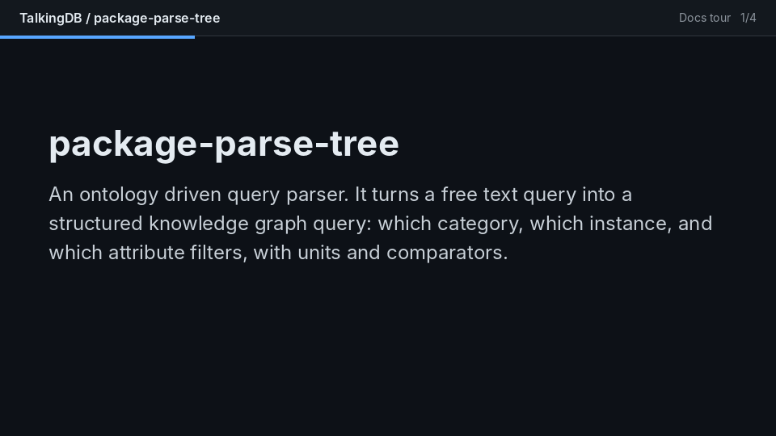

<!-- short-readme -->
<h1 align="center">package-parse-tree</h1>

<p align="center"><b>Turn a free text query into a structured query your catalogue understands.</b></p>

<p align="center"><a href="#try-it">Try it</a> · <a href="docs/architecture.md">How it works</a> · <a href="docs/usage-and-examples.md">Usage and examples</a> · <a href="docs/troubleshooting.md">Troubleshooting</a> · <a href="docs/reference.md">Full reference</a></p>

<p align="center"><a href="https://github.com/TalkingDB/package-parse-tree/stargazers"></a></p>

<p align="center">
  
</p>
<p align="center"><sub>A real run at <code>d820de9</code> on 27 Nov 2026, with the named entity linker in the same process instead of over HTTP. The ontology is built the way <code>tests/unit/services/parsing/test_sentence.py</code> builds one.</sub></p>

Describe a domain as an [ontology](https://en.wikipedia.org/wiki/Ontology_(information_science)) of categories, instances and attributes, and parse-tree turns "m10 316 hex nut" into category, product and attribute filters, with units and comparators, ready for a [knowledge graph](https://en.wikipedia.org/wiki/Knowledge_graph) query.

## What it does

- **Store** your ontology: [register a type](docs/usage-and-examples.md#1-register-a-type) and [write nodes](docs/usage-and-examples.md#2-write-nodes).
- **Teach** [package-named-entity-linker](https://github.com/TalkingDB/package-named-entity-linker) the names, synonyms included ([how](docs/usage-and-examples.md#3-teach-nel-the-names)).
- **Parse** a query into a Category, Instance, Attribute, Value tree ([example](docs/usage-and-examples.md#4-parse-a-query)) and [filter the graph](docs/usage-and-examples.md#5-filter-the-knowledge-graph) with it.

## Try it

```bash
make sync MODE=git
poetry install
make test
make local             # API on http://localhost:8093, Swagger at /docs
```

Anything that extracts text needs a running [package-named-entity-linker](https://github.com/TalkingDB/package-named-entity-linker) on port 8092.

## Where it fits

Used by [module-ecommerce-ai](https://github.com/TalkingDB/module-ecommerce-ai) and [package-search-trainer](https://github.com/TalkingDB/package-search-trainer); asks [package-named-entity-linker](https://github.com/TalkingDB/package-named-entity-linker) what a query contains.

## Learn more

| Page | Read it to |
| :--- | :--- |
| [How it works](docs/architecture.md) | see the parts and how data moves |
| [Usage and examples](docs/usage-and-examples.md) | copy working examples |
| [Troubleshooting](docs/troubleshooting.md) | fix a problem |
| [Full reference](docs/reference.md) | read everything that used to be on this page |
| [All docs](docs/README.md) | see every page |

## Support TalkingDB

If package-parse-tree saved you time, please [give it a star](https://github.com/TalkingDB/package-parse-tree) ⭐. Stars help other developers find the project.

Found a bug, or a document it gets wrong? [Open an issue](https://github.com/TalkingDB/package-parse-tree/issues/new). We are always here to help and open to a conversation. Explore the TalkingDB applications at [talkingdb.io](https://talkingdb.io/#applications).

## License

> [!NOTE]
> This repository does not have a LICENSE file yet. Most TalkingDB repositories are licensed under [AGPL-3.0](https://www.gnu.org/licenses/agpl-3.0.html); until a LICENSE file is added here, no license is granted by this README.
