# Architecture

[Docs home](README.md) › Architecture

How package-parse-tree stores an [ontology](https://en.wikipedia.org/wiki/Ontology_(information_science)), how it trains NEL from it, and how it turns a query into a tree. For setup, start at the [README](../README.md).

## Three jobs, three API groups

| Job | Routes | Main code |
| :--- | :--- | :--- |
| Hold the ontology | `/api/namespaces/{ns}/ontology/types`, `/ontology/data` | [`services/ontology/`](../talkingdb_pt/services/ontology/) |
| Teach NEL the names | `/api/namespaces/{ns}/ner/train`, `/ner/synonyms` | [`services/ner/`](../talkingdb_pt/services/ner/) |
| Understand a query | `/api/namespaces/{ns}/extract/entities`, `/extract/relations` | [`services/parsing/`](../talkingdb_pt/services/parsing/) |
| Filter the [knowledge graph](https://en.wikipedia.org/wiki/Knowledge_graph) | `/api/namespaces/{ns}/kg/data`, `/kg/data/filters/multiple`, `/kg/entities/...` | [`services/kg/`](../talkingdb_pt/services/kg/) |

## How the ontology is stored

Two [SQLite](https://www.sqlite.org/about.html) tables, defined in [`services/ontology/store.py`](../talkingdb_pt/services/ontology/store.py), sit beside an `EntityModel` graph from [base-tdb-models](https://github.com/TalkingDB/base-tdb-models).

| Table | One row is | Columns that matter |
| :--- | :--- | :--- |
| `ontology_types` | A registered type in a namespace | `kg_type_name`, `is_class`, `is_instance`, `class_type_group`, `instance_type_group`, `extra_attrs_json`, `relationship_triples_json` |
| `ontology_node_properties` | Scalar properties of one node | `src_name`, `pt_prec` (decimals that matter), `range_min`, `range_max`, `multiplier` (unit conversion), `shorthands`, `src_url` (where it came from), `is_a`, `contains`, `extra_json` |

Relationships between nodes are edges in the graph. Only two are built in ([`services/ontology/trainer.py`](../talkingdb_pt/services/ontology/trainer.py)):

```text
subclass_of   "Artificial sweetener is a subclass of Sweetener"
instance_of   "Aspartame is an instance of Artificial sweetener"
```

Any other relationship is declared per type in `extra_attrs` with `value_type` `REF` (one target) or `[REF]` (many). Node keys `src_id`, `alternate_names`, `class_type`, `instance_type` and `type_name` are reserved.

## How synonyms reach NEL

<picture>
  <source media="(prefers-color-scheme: dark)" srcset="images/synonym-path-from-ontology-node-to-a-matched-query-dark.svg">
  
</picture>

<sub>Diagram source: [synonym-path-from-ontology-node-to-a-matched-query.mmd](diagrams/synonym-path-from-ontology-node-to-a-matched-query.mmd). Edit it and re-render with the steps in [docs/diagrams](diagrams/README.md).</sub>

In words: the names you give a node become NEL [surface texts](https://github.com/TalkingDB/ConceptDigger/blob/master/docs/concepts.md#surface-texts-every-name-for-a-thing) when you call `/ner/train`, which is what lets NEL point query words back at that node. Code: [`ontology/trainer.py`](../talkingdb_pt/services/ontology/trainer.py) and [`ner/trainer.py`](../talkingdb_pt/services/ner/trainer.py).

> [!IMPORTANT]
> Writing nodes to `/ontology/data` does not train NEL by itself. Call `POST /api/namespaces/{ns}/ner/train` afterwards, or queries will not find the new names.

## From query to tree

[`parse_input`](../talkingdb_pt/services/parsing/sentence.py) runs these steps:

<picture>
  <source media="(prefers-color-scheme: dark)" srcset="images/steps-inside-parse-input-dark.svg">
  
</picture>

<sub>Diagram source: [steps-inside-parse-input.mmd](diagrams/steps-inside-parse-input.mmd). Edit it and re-render with the steps in [docs/diagrams](diagrams/README.md).</sub>

In words: NEL finds the known words, then parse-tree sorts them into categories, instances and attribute filters, works out numbers and units, and returns the categories best matching the query first.

If no category is found, any attributes are returned under an empty category, so a caller can still filter by them.

## Filtering the knowledge graph

`POST /kg/data` takes `filters` (`field`, `op`, `value`), `sorters`, `limit`, `offset` and `fields`. Operators are `eq`, `ge`, `gt`, `le`, `lt` and `in` ([`services/kg/query.py`](../talkingdb_pt/services/kg/query.py)).

A filter field is followed as a graph edge only if it is on this allowlist: `instance_of`, `subclass_of`, `has_attributes`, `has_units`, `default_unit`. Every other field is compared against `ontology_node_properties`. That keeps filters predictable, and it is also why a resolved attribute value such as "red" cannot narrow a graph query yet.

## Configuration

| Variable | Default | Purpose |
| :--- | :--- | :--- |
| `NEL_SERVER` | `http://localhost:8092` | Where NEL runs |
| `CLIENT_MODE` | `direct` | How `PTClient` calls this package |
| `PT_HOST` | none | Base URL when `CLIENT_MODE=api` |
| `AUTH_DB` | `data/auth.db` | API key store (the check is not attached to routes yet) |
| `ENTITY_DB` and other `base-tdb-clients` paths | `data/*.db` | Where the ontology graph is stored |

## Dependencies

As of 25 November 2026 this repository pins `base-tdb-models` at `6ad6e83`, `base-tdb-clients` at `29abea2` and `base-tdb-helpers` at `d7c891b`. It is pinned in turn by [package-search-trainer](https://github.com/TalkingDB/package-search-trainer) and [module-ecommerce-ai](https://github.com/TalkingDB/module-ecommerce-ai) at `1ea5b70`, the current head of `main`.

---

**Related:** [Troubleshooting](troubleshooting.md) · [Usage and examples](usage-and-examples.md) · [README](../README.md)
