# package-parse-tree: full reference

[Back to the README](../README.md)

Everything that was on the front page before it was shortened, unchanged apart from links, so nothing is lost.

An ontology driven natural language query parser. Given an ontology of types, instances and attributes for any domain, it turns a free text query into a structured [knowledge graph](https://en.wikipedia.org/wiki/Knowledge_graph) query: which category, which instance, and which attribute filters, including numbers with units and comparators.


| Start here | Go deeper |
| :--- | :--- |
| [Key terms](#key-terms) | [Architecture: from query to tree](architecture.md) |
| [Where this fits](#where-this-fits) | [Usage and examples: build an ontology and parse a query](usage-and-examples.md) |
| [Quickstart](#quickstart) | [Troubleshooting](troubleshooting.md) |
| [What this repo is not](#what-this-repo-is-not) | [Client (direct or API mode)](#client) |

All pages: [docs/](README.md).

This package is domain agnostic TalkingDB infrastructure: it has no built in concept of "products", "ecommerce" or any other domain. Domain vocabulary and use cases belong to the `module-*` repositories that consume it.

## Key terms

| Term | Meaning | Example |
| :--- | :--- | :--- |
| **Ontology** | The schema of a domain: what kinds of things exist and how they relate | "a Nut is a kind of Fastener" |
| **Class** (category) | A group of things | Nut |
| **Instance** | One specific thing in a class | Hex nut M8 |
| **Attribute** | A property used to filter | material, size |
| **Unit** and **comparator** | How a number is measured and compared | `20` `mm`, "under" |
| **[Surface text](https://github.com/TalkingDB/ConceptDigger/blob/master/docs/concepts.md#surface-texts-every-name-for-a-thing)** | A way people write a name; trained into NEL so the query can be matched | "hexagon nut" |

## Where this fits

<picture>
  <source media="(prefers-color-scheme: dark)" srcset="images/where-package-parse-tree-fits-dark.svg">
  
</picture>

<sub>Diagram source: [where-package-parse-tree-fits.mmd](diagrams/where-package-parse-tree-fits.mmd). Edit it and re-render with the steps in [docs/diagrams](diagrams/README.md).</sub>

In words: callers send text; parse-tree asks NEL which known things it contains, looks them up in its own ontology store, and returns a tree that says what was understood.

## Quickstart

You need Python 3.12 or 3.13, [Poetry](https://python-poetry.org/docs/#installation), the three `base-tdb-*` repositories checked out next to this one, and a running [Named Entity Linker](https://github.com/TalkingDB/package-named-entity-linker) on port 8092 for anything that extracts text.

```bash
make sync MODE=git      # or MODE=local for editable base-tdb-* checkouts
poetry install
make test
make local              # API on http://localhost:8093, Swagger at /docs
```

See the `Makefile` for the full list of targets.

## What a parsed query looks like

`POST /api/namespaces/{namespace}/extract/relations` returns an `NLOutput` ([model/nl.py](../talkingdb_pt/model/nl.py)). Its core is a list of category groups:

```text
Category
  ├── Instances
  │     └── Attributes
  └── Attributes
        ├── unit          (mm, kg)
        └── values
              └── comparator  (under, over, between)
```

So "stainless nuts under 20mm" is meant to become a `Nut` category with a `material` attribute valued `stainless` and a `size` attribute valued `20`, unit `mm`, comparator "less than". Any query UI should render this tree, because showing it is how a user sees that the system understood rather than guessed.

## Client

`talkingdb_pt.client.PTClient` gives callers one interface that works two ways, chosen by the `CLIENT_MODE` environment variable (default `direct`):

- **Direct mode** calls the same service functions the API routers call, in process. No server is needed; useful when this package is embedded as a library inside another service.
- **API mode** calls a deployed package-parse-tree service over HTTP. Set `CLIENT_MODE=api` and `PT_HOST` to its base URL.

```python
from talkingdb_pt.client import PTClient

client = PTClient()  # direct mode by default
result = await client.extract_relations("acme", "red running shoes under $50")
```

## What this repo is not

- **Not a user interface.** There is no screen for browsing or editing the ontology today; everything goes through the API.
- **Not a full graph database.** The ontology lives in [SQLite](https://www.sqlite.org/about.html) through `EntityModel`. There is no Dgraph style schema apply step.
- **Not a relationship reasoner beyond its allowlist.** Only `subclass_of` and `instance_of` are built in. Other relationships must be declared per type with `extra_attrs`, and the filter engine only follows a fixed set of edges.
- **Not secured by default.** An API key check exists in [`services/auth.py`](../talkingdb_pt/services/auth.py) but is not attached to any route. Put the service behind a gateway before exposing it.

## Related repositories

| Repository | Relationship |
| :--- | :--- |
| [package-named-entity-linker](https://github.com/TalkingDB/package-named-entity-linker) | Called over HTTP to train synonyms and to find entities in the query |
| [base-tdb-models](https://github.com/TalkingDB/base-tdb-models) | `EntityModel` stores the ontology and knowledge graph |
| [module-ecommerce-ai](https://github.com/TalkingDB/module-ecommerce-ai) | Uses `PTClient` to decide between the knowledge graph path and vector search |
| [package-search-trainer](https://github.com/TalkingDB/package-search-trainer) | Pins this package; crawled data can be shaped into ontology nodes by the caller |
| [CommandNet-Processor](https://github.com/TalkingDB/CommandNet-Processor) | The 2016 ancestor of this parser |

## Further reading

- [Ontology (information science)](https://en.wikipedia.org/wiki/Ontology_(information_science))
- [Parse tree](https://en.wikipedia.org/wiki/Parse_tree)
- [FastAPI documentation](https://fastapi.tiangolo.com/)
