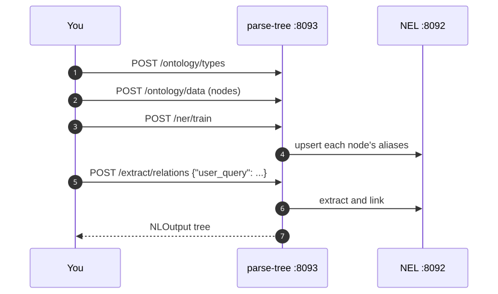

# Usage and examples

[Docs home](README.md) › Usage and examples

Build a small [ontology](https://en.wikipedia.org/wiki/Ontology_(information_science)), teach NEL its names, then parse a query. The requests and responses marked "asserted by a test" are exactly what the repository's tests check.

```bash
PT=http://localhost:8093
NS=demo
```

Start [package-named-entity-linker](https://github.com/TalkingDB/package-named-entity-linker) on port 8092 first, and create the same namespace there (`POST /api/namespaces` with `{"name": "demo"}`), because parse-tree trains and queries NEL in that namespace.

<picture>
  <source media="(prefers-color-scheme: dark)" srcset="images/building-and-querying-an-ontology-dark.svg">
  
</picture>

<sub>Diagram source: [building-and-querying-an-ontology.mmd](diagrams/building-and-querying-an-ontology.mmd). Edit it and re-render with the steps in [docs/diagrams](diagrams/README.md).</sub>

In words: register types, write nodes, train NEL from them, then parse queries.

## 1. Register a type

```bash
curl -s -X POST "$PT/api/namespaces/$NS/ontology/types" \
  -H "Content-Type: application/json" \
  -d '{"type_name": "category", "create_class": true, "metadata": {"class_type": "category"}}'
```

Response (asserted by a test in [`tests/unit/api/test_ontology.py`](../tests/unit/api/test_ontology.py)):

```json
{"kg_type_name": "Class_Type_Category", "status": "registered"}
```

To declare a relationship beyond the built in two, add it to `extra_attrs`, for example `{"has_attributes": {"value_type": "[REF]"}}`.

## 2. Write nodes

```bash
curl -s -X POST "$PT/api/namespaces/$NS/ontology/data" \
  -H "Content-Type: application/json" \
  -d '[{"src_id": "electronics", "class_type": "category", "src_name": "Electronics"},
       {"src_id": "smartphones", "class_type": "category"}]'
```

Response (asserted by the same test):

```json
{"node_ids": ["electronics", "smartphones"]}
```

`GET /api/namespaces/$NS/ontology/data` then returns `{"namespace": "<ns>", "nodes_trained": 2}`. Writing a node whose `class_type` was never registered returns `400`.

Give a node synonyms with `alternate_names`, for example `{"src_id": "smartphones", "class_type": "category", "alternate_names": ["mobile phone", "cell phone"]}`.

## 3. Teach NEL the names

```bash
curl -s -X POST "$PT/api/namespaces/$NS/ner/train"
```

The response counts `total_trainable_entities_in_kg`, `entities_trained` and `entities_skipped`. One failing node is skipped instead of stopping the whole run, so check `entities_skipped`.

Manage single synonyms with `POST`, `GET` and `DELETE` on `/ner/synonyms`, or many at once with `POST /ner/synonyms/many`.

## 4. Parse a query

```bash
curl -s -X POST "$PT/api/namespaces/$NS/extract/relations" \
  -H "Content-Type: application/json" \
  -d '{"user_query": "cell phones under 20000 rupees"}'
```

The response is an `NLOutput` ([`model/nl.py`](../talkingdb_pt/model/nl.py)):

| Field | Meaning |
| :--- | :--- |
| `parse_tree_output.groups` | Categories, best match first, each with `instances` and `attributes` |
| `no_tag_entities` | Words NEL could not place |
| `entities_extracted` | What NEL returned, by ID |
| `search_weight`, `total_tokens` | Signals callers use to judge how much of the query was understood |

To see only what NEL found, without the ontology step, use `POST /extract/entities` with the same body plus an optional `word_correction`.

## 5. Filter the knowledge graph

```bash
curl -s -X POST "$PT/api/namespaces/$NS/kg/data" \
  -H "Content-Type: application/json" \
  -d '{"filters": [{"field": "instance_of", "op": "eq", "value": "smartphones"}], "limit": 20}'
```

Operators: `eq`, `ge`, `gt`, `le`, `lt`, `in`. Edge fields are limited to an allowlist; see [architecture.md](architecture.md#filtering-the-knowledge-graph).

## Use it as a library

```python
from talkingdb_pt.client import PTClient

client = PTClient()  # CLIENT_MODE=direct by default
tree = await client.extract_relations("demo", "cell phones under 20000 rupees")
```

Set `CLIENT_MODE=api` and `PT_HOST=http://host:8093` to call a deployed service instead, with no code change.

## Further reading

- [FastAPI testing with TestClient](https://fastapi.tiangolo.com/tutorial/testing/), the pattern the tests above use
- [HTTPX async client](https://www.python-httpx.org/async/), used to call NEL

---

**Related:** [Architecture](architecture.md) · [Troubleshooting](troubleshooting.md) · [README](../README.md)
